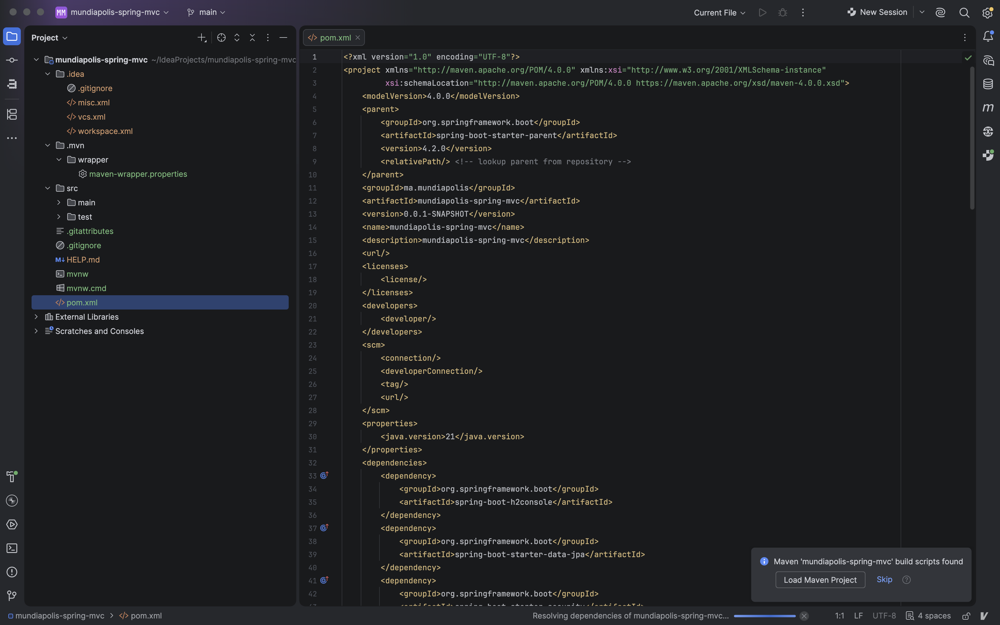
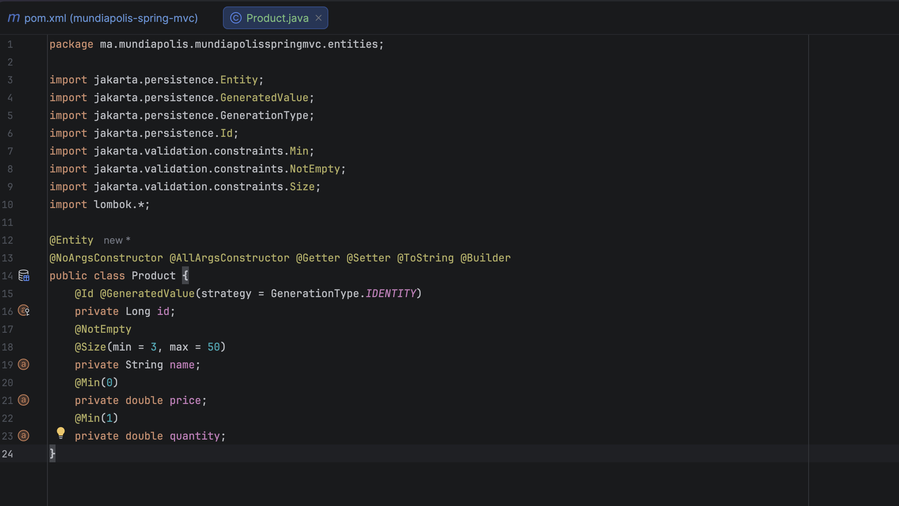
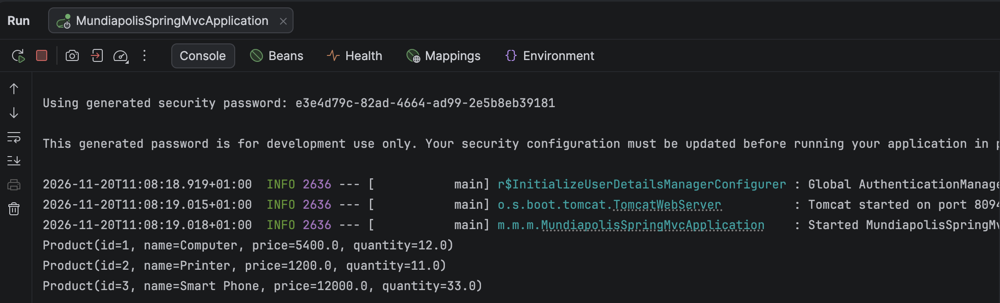
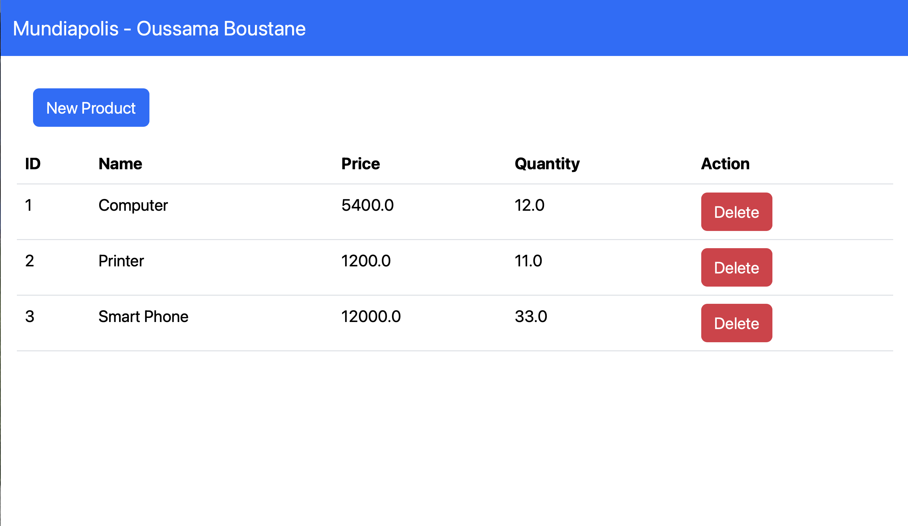
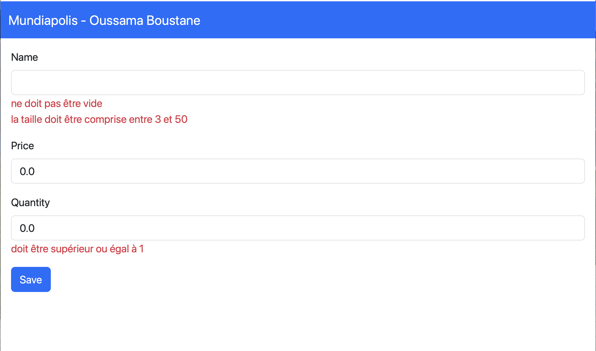
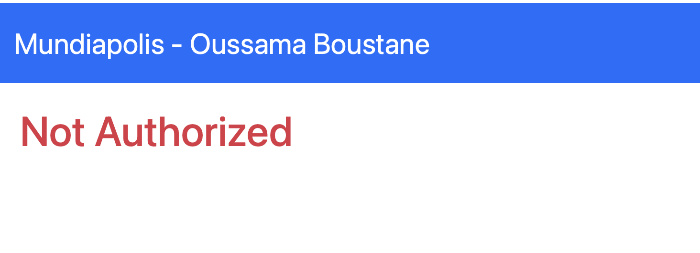
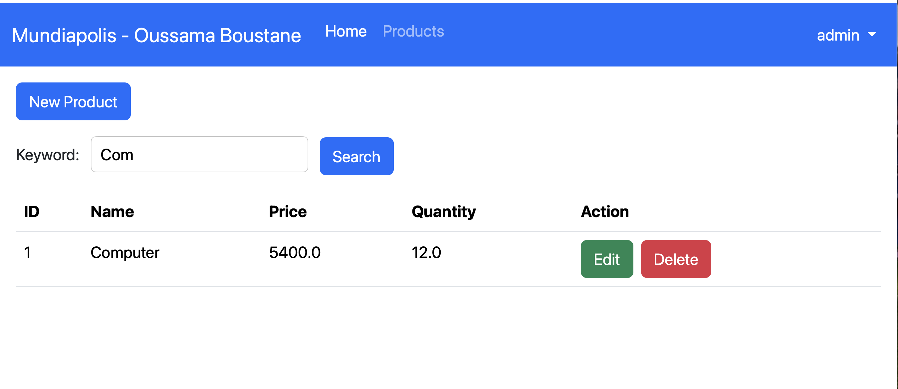

<h1>Compte-rendu — Activité Pratique N°3 : Spring MVC, Thymeleaf &amp; Spring Security</h1>

<strong>Réalisé par :</strong> Oussama Boustane

<strong>Établissement :</strong> Université Mundiapolis

<strong>Dépôt GitHub :</strong> <a href="https://github.com/oboussamaboustane-eng/tp3-spring-mvc-security">https://github.com/oboussamaboustane-eng/tp3-spring-mvc-security</a>

<h2>Objectif de l'activité pratique</h2>

Développer une application web complète de gestion de produits basée sur l'architecture <strong>Spring MVC</strong> avec rendu HTML côté serveur via <strong>Thymeleaf</strong>, persistance des données avec <strong>Spring Data JPA</strong> (H2 / MySQL), validation des formulaires côté serveur et sécurisation de l'application avec <strong>Spring Security</strong> (authentification <em>Stateful</em>, gestion des rôles <code>USER</code> et <code>ADMIN</code>, hachage des mots de passe avec <code>BCrypt</code> et protection contre les failles <strong>CSRF</strong>).

<h2>Architecture et Stack Technique</h2>
<ul>
  <li><strong>Langage &amp; Build :</strong> Java 21, Maven</li>
  <li><strong>Framework Backend :</strong> Spring Boot, Spring Web (MVC), Spring Data JPA</li>
  <li><strong>Base de données :</strong> H2 Database (en mémoire) &amp; pilote MySQL</li>
  <li><strong>Moteur de templates &amp; UI :</strong> Thymeleaf, Thymeleaf Layout Dialect, Bootstrap 5 (WebJars)</li>
  <li><strong>Validation &amp; Productivité :</strong> Spring Validation (Jakarta Bean Validation), Lombok</li>
  <li><strong>Sécurité :</strong> Spring Security 6/7, Thymeleaf Extras Spring Security</li>
</ul>

<h2>1. Initialisation du projet Spring Boot</h2>

Création du projet Maven <code>mundiapolis-spring-mvc</code> (groupe <code>ma.mundiapolis</code>) dans IntelliJ IDEA avec Java 21 et sélection des dépendances : <em>Spring Web, Spring Data JPA, H2 Database, MySQL Driver, Lombok, Thymeleaf, Spring Validation</em> et <em>Spring Security</em>.

<h2>2. Création de l'entité JPA Product</h2>

Création de la classe entité <code>Product</code> dans le package <code>ma.mundiapolis.mundiapolisspringmvc.entities</code>. Elle est annotée avec <code>@Entity</code>, <code>@Id</code> et <code>@GeneratedValue(strategy = GenerationType.IDENTITY)</code> pour le mapping objet-relationnel, les annotations Lombok (<code>@NoArgsConstructor</code>, <code>@AllArgsConstructor</code>, <code>@Getter</code>, <code>@Setter</code>, <code>@ToString</code>, <code>@Builder</code>) ainsi que les règles de validation (<code>@NotEmpty</code>, <code>@Size(min = 3, max = 50)</code>, <code>@Min(0)</code>, <code>@Min(1)</code>).

<h2>3. Création de l'interface ProductRepository</h2>

Création de l'interface <code>ProductRepository</code> dans le package <code>repository</code>, étendant <code>JpaRepository&lt;Product, Long&gt;</code> afin d'hériter des opérations CRUD standards (<code>save</code>, <code>findAll</code>, <code>findById</code>, <code>deleteById</code>).

<h2>4. Test de la couche DAO</h2>

Configuration du port serveur (<code>8094</code>) et de la source de données H2 en mémoire (<code>jdbc:h2:mem:products-db</code>) dans <code>application.properties</code>. Un bean <code>CommandLineRunner</code> insère trois produits initiaux (<em>Computer</em>, <em>Printer</em>, <em>Smart Phone</em>) au démarrage de l'application et les affiche dans la console.

<h2>5. Désactivation temporaire de la protection Spring Security</h2>

Avant d'implémenter la politique de sécurité personnalisée, la configuration automatique de Spring Security est temporairement exclue via <code>@SpringBootApplication(exclude = ...)</code>, permettant un accès direct à la console H2 (<code>/h2-console</code>) pour vérifier la création et le contenu de la table <code>PRODUCT</code>.

<h2>6. Contrôleur Spring MVC, Layout Thymeleaf &amp; Validation</h2>

<h3>6.1 Template principal et affichage de la liste</h3>

Mise en place d'une page maître <code>layout1.html</code> basée sur <strong>Thymeleaf Layout Dialect</strong> et <strong>Bootstrap 5</strong> (barre de navigation commune <em>Mundiapolis - Oussama Boustane</em> et fragment dynamique <code>content1</code>). Le contrôleur <code>ProductController</code> expose les routes d'affichage (<code>products.html</code>) et de suppression avec confirmation JavaScript.

<h3>6.2 Formulaire d'ajout et validation côté serveur</h3>

Création de la vue <code>new-product.html</code> reliée à la méthode <code>@PostMapping("/saveProduct")</code> utilisant <code>@Valid</code> et <code>BindingResult</code>. Si les contraintes définies sur l'entité <code>Product</code> ne sont pas respectées, l'utilisateur est renvoyé vers le formulaire avec les messages d'erreur affichés en rouge via <code>th:errors</code>.

<h3>6.3 Vérification de l'ajout d'un produit valide</h3>

Après saisie de valeurs conformes (<em>MacBook</em>, prix <code>15000.0</code>, quantité <code>5.0</code>), le produit est persisté en base de données et apparaît immédiatement dans la liste.

<h2>7. Sécurisation de l'application avec Spring Security</h2>

<h3>7.1 Configuration de la sécurité et authentification personnalisée</h3>

Réactivation de Spring Security et création de la classe <code>SecurityConfig</code> (<code>@Configuration</code>, <code>@EnableWebSecurity</code>) :

<ul>
  <li><strong>Hachage des mots de passe :</strong> Déclaration d'un bean <code>BCryptPasswordEncoder</code> afin de ne jamais stocker de mots de passe en clair.</li>
  <li><strong>Authentification In-Memory :</strong> Définition des comptes <code>user1</code>, <code>user2</code> (rôle <code>USER</code>) et <code>admin</code> (rôles <code>USER</code> et <code>ADMIN</code>).</li>
  <li><strong>Filtrage des URLs (<code>SecurityFilterChain</code>) :</strong> Restriction de <code>/user/**</code> au rôle <code>USER</code>, restriction de <code>/admin/**</code> au rôle <code>ADMIN</code>, page de connexion personnalisée <code>/login</code> et gestion des accès refusés vers <code>/notAuthorized</code>.</li>
  <li><strong>Protection CSRF :</strong> Activation de la protection par jeton synchroniseur (<em>Synchronizer Token</em>) et passage de l'opération de suppression en requête <code>POST</code> (<code>@PostMapping("/admin/delete")</code>) via un formulaire Thymeleaf.</li>
</ul>

<h3>7.2 Session utilisateur (Rôle USER) et masquage contextuel</h3>

Lorsqu'un utilisateur connecté possède uniquement le rôle <code>USER</code> (<code>user1</code>), son identifiant s'affiche dans la barre de navigation via <code>sec:authentication="name"</code>, tandis que les boutons d'ajout, d'édition et de suppression sont masqués grâce à <code>sec:authorize="hasRole('ADMIN')"</code>.

<h3>7.3 Gestion des accès non autorisés (Erreur 403 / Not Authorized)</h3>

Si <code>user1</code> tente d'accéder directement par URL à une ressource réservée aux administrateurs (ex. <code>/admin/newProduct</code>), Spring Security intercepte l'exception d'accès refusé et redirige vers la page dédiée <code>notAuthorized.html</code>.

<h3>7.4 Session administrateur (Rôle ADMIN)</h3>

Lorsqu'un utilisateur connecté dispose du rôle <code>ADMIN</code> (<code>admin</code>), l'intégralité des actions d'administration (ajout, modification, suppression) est accessible et autorisée.

<h2>8. Fonctionnalités supplémentaires : Recherche et Édition</h2>

<h3>8.1 Recherche de produits par mot-clé</h3>

Ajout de la méthode dérivée <code>List&lt;Product&gt; findByNameContains(String kw)</code> dans <code>ProductRepository</code> et intégration d'un formulaire de recherche dans <code>products.html</code> permettant de filtrer dynamiquement la liste des produits selon le mot-clé saisi.

<h3>8.2 Édition et mise à jour d'un produit</h3>

Ajout de la route sécurisée <code>@GetMapping("/admin/editProduct")</code> dans <code>ProductController</code> et création de la vue <code>edit-product.html</code> contenant un champ caché <code>id</code> afin de mettre à jour un produit existant dans la base de données.

<h2>Conclusion</h2>

Cette activité pratique a permis de mettre en œuvre une architecture web complète sous <strong>Spring Boot</strong> en articulant la couche d'accès aux données (Spring Data JPA), le rendu serveur (Spring MVC &amp; Thymeleaf Layout) et la sécurisation de bout en bout avec <strong>Spring Security</strong> (authentification <em>Stateful</em>, contrôle d'accès basé sur les rôles, hachage <code>BCrypt</code> et protection contre les attaques <strong>CSRF</strong>).
