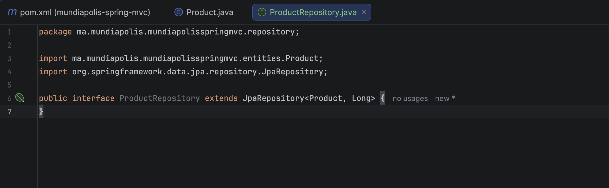
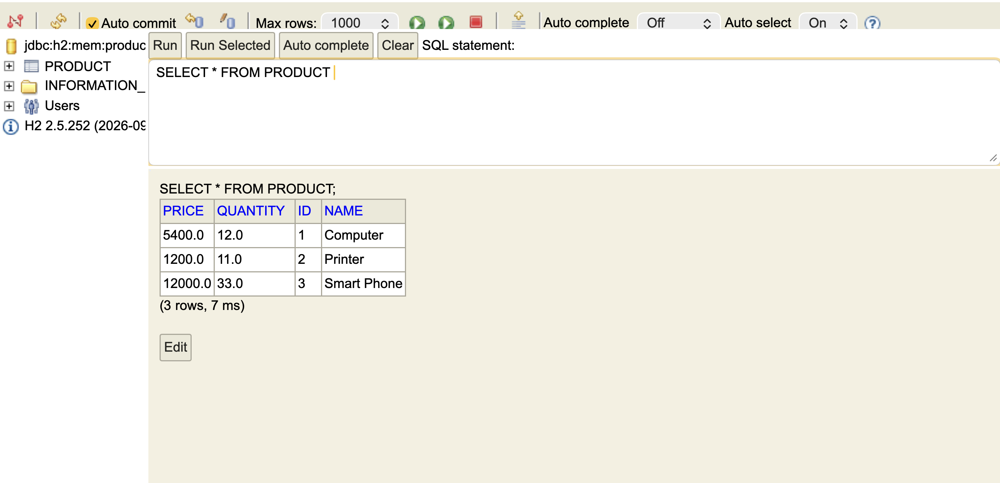
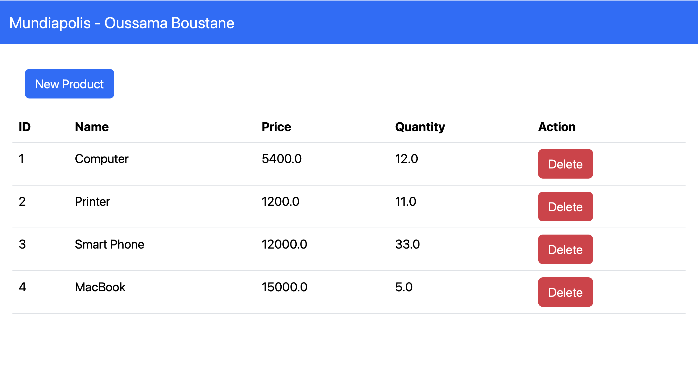
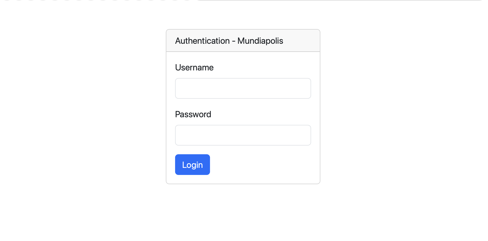
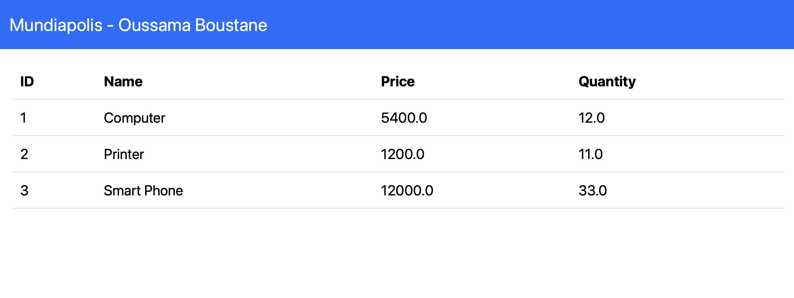
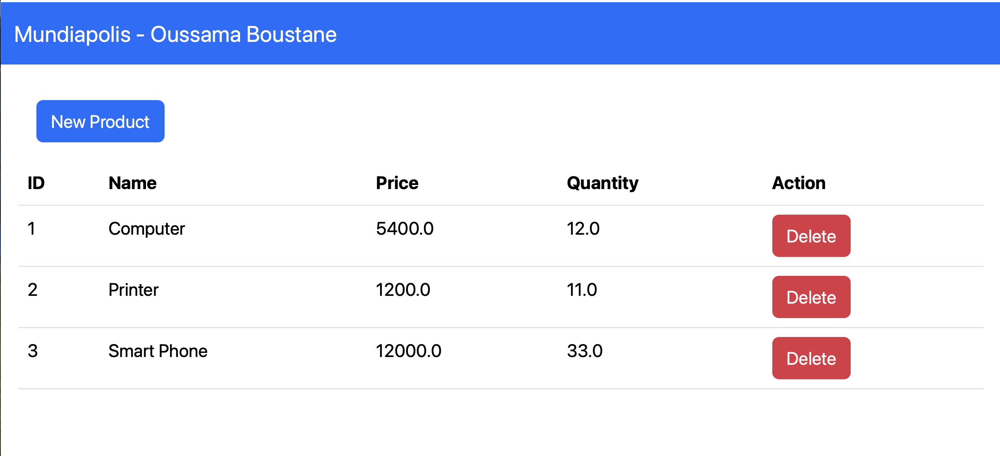
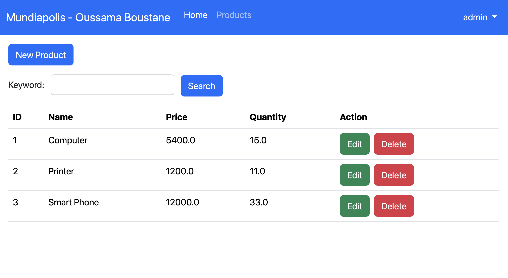

<h1>Compte-rendu Activité Pratique N°3 : Spring MVC, Thymeleaf & Spring Security</h1>

<strong>Réalisé par :</strong> Oussama Boustane

<strong>Établissement :</strong> Université Mundiapolis

<h2>1. Initialisation du projet Spring Boot</h2>

<h2>2. Création de l'entité JPA Product</h2>

<h2>3. Interface ProductRepository</h2>

<h2>4. Test de la couche DAO</h2>

<h2>5. Désactivation temporaire de Spring Security et Console H2</h2>

<h2>6. Contrôleur Spring MVC, Layout Bootstrap et Validation</h2>

<h2>7. Sécurisation avec Spring Security</h2>

<h2>8. Fonctionnalités supplémentaires : Recherche et Édition</h2>

